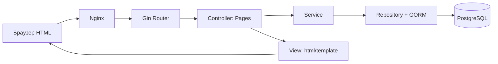

# Серверный MVC в Task Tracker

## Что такое MVC в текущей реализации

- **Model** — `backend/internal/model`: таблицы/структуры GORM (`User`, `Session`, `Project`, `Membership`, `Task`, `Review`) и доменные расчёты приоритета.
- **View** — `backend/internal/view/pages.go` плюс HTML-файлы `backend/internal/view/templates/`: Go `html/template` получает данные от Controller и генерирует **готовый HTML на сервере**, экранируя пользовательские значения. CSS хранится в `view/static/style.css` и встраивается в Go-бинарник через `//go:embed`.
- **Controller** — `backend/internal/controller/pages.go`: принимает GET/POST, проверяет CSRF, cookies, данные HTML-форм, вызывает Service, возвращает HTML или перенаправление 303.

Это серверный MVC с выделенными **Service** (права доступа и бизнес-сценарии) и **Repository** (SQL/GORM, транзакции). Controller не пишет SQL, View не обращается к БД.

## Схема



Пример: `GET /projects/2` → Router → `Pages.Project()` → `Service.ProjectDetails()` и `Service.Tasks()` → Repository → `view.Render("project")` → `200 text/html`.

Отправка формы: `POST /projects/2/tasks` → проверка CSRF → Controller валидирует входные поля → `Service.CreateTask()` проверяет роль → Repository сохраняет задачу → `303 See Other` → браузер снова делает GET и получает готовую HTML-страницу. Это **Post/Redirect/Get**.

## Каталоги

```text
backend/cmd/server/main.go             запуск и связывание слоёв
backend/internal/router/router.go      REST-маршруты и Swagger
backend/internal/router/pages.go       серверные HTML-маршруты
backend/internal/controller/pages.go   HTML-контроллер, формы и CSRF
backend/internal/controller/           REST-контроллеры (отдельный API)
backend/internal/model/models.go       Model, GORM-структуры
backend/internal/view/pages.go         HTML-шаблонизатор
backend/internal/view/templates/       готовые виды страниц
backend/internal/view/static/style.css стили
backend/internal/service/             бизнес-логика проектов, задач, ревью
backend/internal/repository/          запросы PostgreSQL через GORM
backend/internal/migration/           CodeFirst и миграции
backend/internal/config/              настройки
backend/internal/cache/               кэш статистики
infra/nginx.conf                       reverse proxy к Gin
Dockerfile / compose.yaml             окружение
```

## Страницы

| URL | HTTP | Назначение |
|---|---|---|
| `/login`, `/register` | GET/POST | вход и регистрация |
| `/` | GET | обзор проектов и статистики |
| `/projects` | GET/POST | список, поиск и создание проекта |
| `/projects/:id` | GET | задачи, роли участников, фильтры |
| `/projects/:id/tasks/new` | GET | форма создания задачи |
| `/projects/:id/tasks/:taskID/edit` | GET | форма редактирования |
| `/projects/:id/tasks/:taskID/submit` | POST | отправка отчёта на проверку |
| `/projects/:id/tasks/:taskID/review` | POST | одобрение или отказ |
| `/admin` | GET | управление глобальными пользователями |
| `/about` | GET | справка |
| `/swagger`, `/api/*` | GET/JSON-методы | отдельный REST API |

Все изменяющие HTML-маршруты используют POST и требуют CSRF-токен. Неавторизованному пользователю закрытые HTML-страницы возвращают перенаправление на вход, а запрещённая операция возвращает ошибку 403. Сервисный слой всегда проверяет права независимо от скрытия кнопок в шаблонах.

## Чем REST отличается от MVC

**MVC** — способ структурирования кода по слоям Model/View/Controller.

**REST** — стиль проектирования HTTP API (`GET /api/projects`, `POST /api/projects`, `PATCH /api/projects/2`). Он не предписывает, что должен быть отдельный View в смысле HTML-шаблонов.

В текущем проекте браузер получает HTML через серверные MVC-контроллеры, а REST API оставлен для Swagger/внешних клиентов. Поэтому оба подхода сосуществуют, но основной сайт теперь **не SPA** и не работает через fetch-запросы к REST API.

## Kanban без JavaScript SPA

Страница `/projects/:id` остаётся **серверным MVC**: `Pages.Project` получает задачи через сервис и распределяет их в `TaskColumn` по статусам `todo`, `in_progress`, `in_review`, `done`. Go-шаблон `view/templates/project.html` рендерит четыре колонки и карточки задач. Даже пустые колонки остаются видимыми. CSS обеспечивает горизонтальную прокрутку на узких экранах. Фильтрация по поисковому запросу (`?q=`), редактирование, запуск, отправка на ревью и принятие решения работают через GET/POST и редирект, без JS-роутинга и клиентской сборки Kanban.