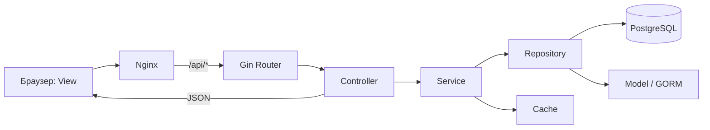

# Архитектура Task Tracker (MVC + Service + Repository)

## Выбор подхода

Приложение построено по **MVC с разделением ответственности**: **Model** — предметная область и структуры GORM; **View** — HTML/CSS/JavaScript интерфейс; **Controller** — Gin-обработчики HTTP. Чтобы контроллеры не содержали SQL и бизнес-логику, добавлены **Service** (use cases) и **Repository** (доступ к PostgreSQL). Это расширенный MVC, не чистая трёхслойная реализация.

## Структура каталогов

```text
backend/
  cmd/server/main.go            # composition root: конфигурация, БД, миграции, запуск
  internal/
    model/models.go             # M: сущности User, Project, Task, Review и правила срочности
    view/swagger.go             # V: шаблон страницы документации API
    controller/                 # C: Gin request binding, HTTP status, JSON, cookies
      auth.go
      projects.go
      tasks.go
      controller.go
      validation.go
    service/
      service.go             # авторизация, сессии, настройки, общие сценарии
      projects.go            # права доступа и жизненный цикл проектов
      tasks.go               # задачи, инварианты и ревью
    repository/
      store.go               # подключение, транзакции, пользователи и сессии
      projects.go            # GORM для проектов и участников
      tasks.go               # GORM для задач и ревью
      dashboard.go           # агрегаты для главной страницы
    router/router.go            # URL -> controller, middleware
    migration/migrate.go        # Code First с версией схемы
    cache/dashboard.go          # краткосрочный кэш dashboard
    config/config.go            # переменные среды
frontend/                       # V: index.html, app.js, style.css (SPA)
infra/nginx.conf                # раздача View и проксирование API
Dockerfile                      # multi-stage сборка Go API
compose.yaml                    # db + api + web
```

## Путь запроса



1. `frontend/app.js` использует собственный клиентский роутинг и обращается к `/api`.
2. `router` выбирает обработчик и запускает JWT middleware для закрытых маршрутов.
3. `controller` валидирует поля (`binding`), получает текущего пользователя из контекста, вызывает сценарий в `service` и возвращает ответ.
4. `service` проверяет права владельца/менеджера/исполнителя, управляет состояниями и транзакциями; не знает о Gin.
5. `repository` выполняет единственную работу с GORM и PostgreSQL. SQL и транзакционные блокировки не попадают в контроллеры.
6. `model` хранит Code First-модели и чистую функцию расчёта `Urgency`.

## Сущности и связи

- `User` — глобальная роль `user/admin`.
- `Session` — хранит хэш идентификатора JWT (JTI), дату истечения и отзыва, связана с `User`.
- `Project` — автор и текущий владелец (`CreatedBy`, `OwnerID`).
- `Membership` — связь many-to-many между `Project` и `User`, роль `owner/manager/member`, уникальная пара `(project_id, user_id)`.
- `Task` — принадлежит `Project`, имеет автора, опционального исполнителя, статус, приоритет, теги, эпик, дедлайн.
- `Review` — история заявок на проверку `Task`, результат и комментарий проверяющего.

## Правила доступа и workflow

- Неавторизованные посетители: регистрация и вход.
- Авторизованные: просмотр своих проектов и задач, статистика, поиск пользователей.
- Владелец/менеджер: создание и редактирование задач, приглашения, ревью; только текущий владелец меняет роли участников и передаёт владение.
- Удалить проект может текущий владелец **либо исходный создатель**; глобальный администратор не может удалять чужой проект, если не является его создателем/владельцем.
- Исполнитель может перевести назначенную ему задачу из `todo` в `in_progress`, затем отправить на проверку с описанием работы **или** URL.
- При отправке на ревью транзакция блокирует строку задачи; создаётся `Review(pending)`, задача становится `in_review`.
- Проверяющий (`owner/manager/admin`) не может проверять собственную заявку. `approved` → `done` с `completed_at`; `rejected` → `in_progress` с комментарием. Изменения задачи и ревью выполняются атомарно.

## Схема и миграции

`migration.Apply` создаёт техническую таблицу `schema_migrations` и выполняет миграцию **v1**: GORM `AutoMigrate` по моделям. Повторный запуск не пересоздаёт таблицы и не стирает содержимое. Новые изменения структуры добавляются отдельными миграциями **v2, v3...** (Code First, с фиксированным номером), а не через опасное удаление БД. Для учебного проекта этого достаточно; для production потребуются SQL-миграции с явной стратегией rollback.

## Конфигурация и запуск

`config.Load` читает `DATABASE_URL`, `JWT_SECRET`, `PORT`, `COOKIE_SECURE`, `BOOTSTRAP_ADMIN_EMAIL`, `BOOTSTRAP_ADMIN_PASSWORD` из окружения. `Dockerfile` компилирует `./cmd/server`; Docker Compose запускает Postgres, API и Nginx с SPA. Секреты и пароль БД сохраняются локально в `.env`, не в Git.

```bash
cp .env.example .env
# Измените JWT_SECRET, POSTGRES_PASSWORD и при необходимости данные первого админа
docker compose up --build -d
```

Приложение: `http://localhost:8080`, Swagger: `http://localhost:8080/swagger`.

## Тесты

- `internal/model/models_test.go`: сроки и ручной приоритет без БД.
- `internal/router/router_test.go`: полный HTTP/JWT/права/ревью сценарий с временной PostgreSQL-БД (только с `TEST_DATABASE_URL`).
- CI: `go test ./...`, `go vet ./...`, `go build ./cmd/server`, `node --check frontend/app.js`.

Полный список эндпоинтов описан в `docs/openapi.yaml`.